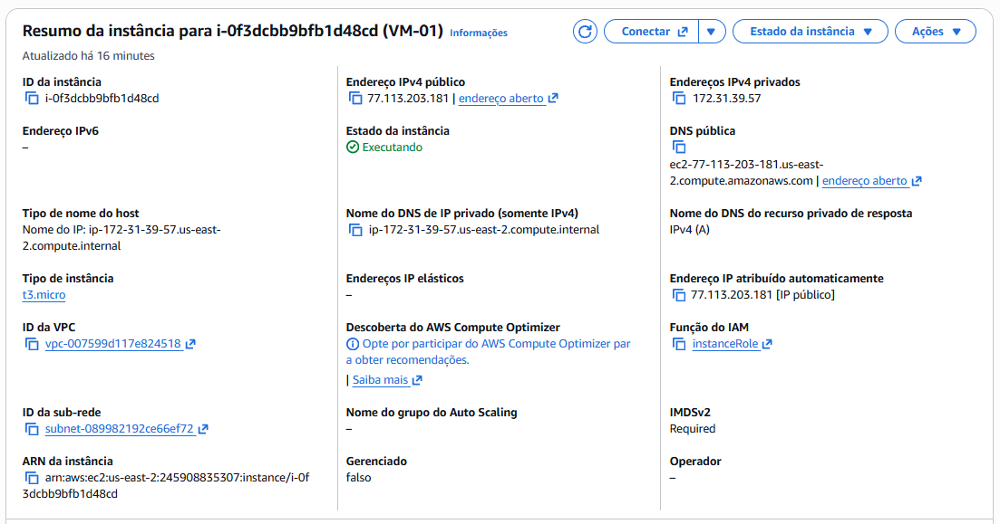
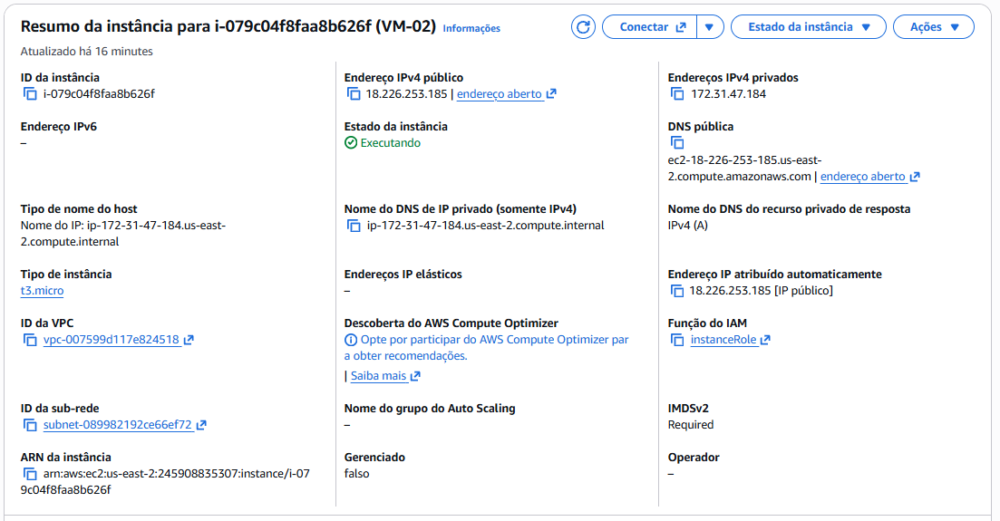
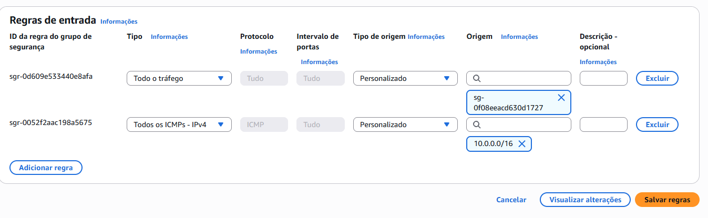
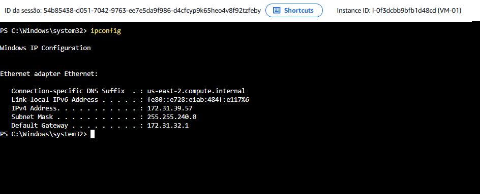
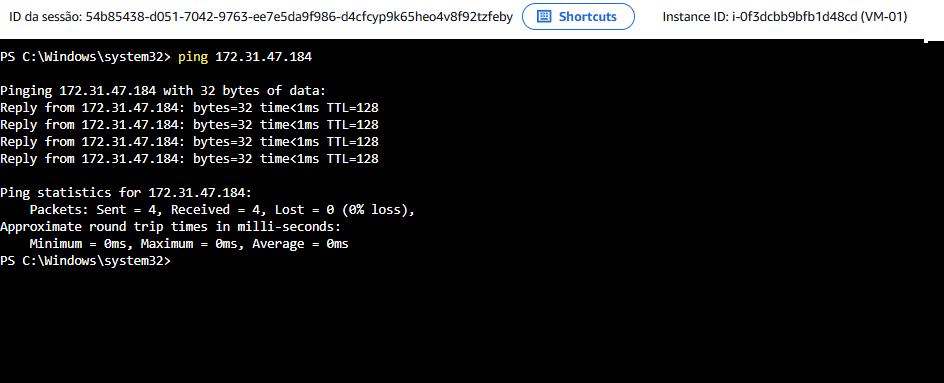
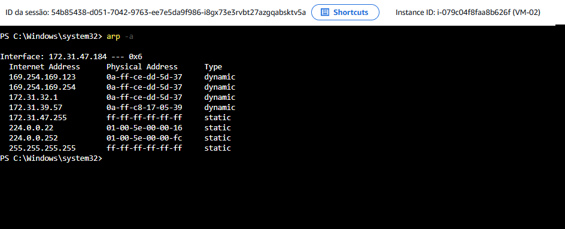

# Relatório de Atividade Prática: Implantação e Diagnóstico de Rede na Amazon Web Services (AWS)

## Sumário
1. [Visão Geral do Projeto](#1-visão-geral-do-projeto)
2. [Arquitetura e Recursos Implantados](#2-arquitetura-e-recursos-implantados)
3. [Procedimento de Configuração](#3-procedimento-de-configuração)
   - [3.1. Provisionamento das Instâncias EC2](#31-provisionamento-das-instâncias-ec2)
   - [3.2. Gerenciamento de Acesso Remoto via AWS Systems Manager (Session Manager)](#32-gerenciamento-de-acesso-remoto-via-aws-systems-manager-session-manager)
   - [3.3. Configuração de Regras de Segurança (Security Group) e Firewall](#33-configuração-de-regras-de-segurança-security-group-e-firewall)
4. [Validação de Conectividade e Execução dos Comandos](#4-validação-de-conectividade-e-execução-dos-comandos)
   - [4.1. Verificação do Adaptador de Rede (ipconfig)](#41-verificação-do-adaptador-de-rede-ipconfig)
   - [4.2. Teste de Acessibilidade da Camada de Rede (ping)](#42-teste-de-acessibilidade-da-camada-de-rede-ping)
   - [4.3. Inspeção da Tabela de Resolução de Endereços (arp -a)](#43-inspeção-da-tabela-de-resolução-de-endereços-arp--a)
5. [Análise Técnica: Comportamento do Protocolo ARP e Mapeamentos Dinâmicos na VPC](#5-análise-técnica-comportamento-do-protocolo-arp-e-mapeamentos-dinâmicos-na-vpc)
6. [Conclusão](#6-conclusão)

---

## 1. Visão Geral do Projeto

Este repositório documenta a atividade prática de criação, configuração e validação de comunicação entre duas instâncias de Máquinas Virtuais (EC2) hospedadas na plataforma de nuvem Amazon Web Services (AWS).

O objetivo principal consiste em demonstrar o ciclo de vida básico de infraestrutura como serviço (IaaS) no ecossistema AWS, cobrindo o provisionamento dos recursos em uma Virtual Private Cloud (VPC), a gestão de acesso seguro sem dependência de IP público direto via AWS Systems Manager (Session Manager), e a validação do tráfego de rede por meio dos utilitários de linha de comando `ipconfig`, `ping` e `arp`.

---

## 2. Arquitetura e Recursos Implantados

A topologia foi implantada alocando ambas as instâncias EC2 na região `us-east-2` (Ohio), vinculadas à mesma VPC e sub-rede pública.

| Parâmetro / Recurso | Instância 1 (VM-01) | Instância 2 (VM-02) |
| :--- | :--- | :--- |
| **Nome da VM** | VM-01 | VM-02 |
| **ID da Instância** | `i-0f3dcbb9bfb1d48cd` | `i-079c04f8faa8b626f` |
| **Sistema Operacional** | Windows Server Datacenter | Windows Server Datacenter |
| **Tipo de Instância** | `t3.micro` | `t3.micro` |
| **Região / AZ** | us-east-2c | us-east-2c |
| **VPC** | `vpc-007599d117e824518` | `vpc-007599d117e824518` |
| **Sub-rede** | `subnet-089982192ce66ef72` (172.31.32.0/20) | `subnet-089982192ce66ef72` (172.31.32.0/20) |
| **Endereço IP Privado** | 172.31.39.57 | 172.31.47.184 |
| **Endereço IP Público** | 77.113.203.181 | 18.226.253.185 |
| **Função do IAM (Role)** | `instanceRole` | `instanceRole` |

---

## 3. Procedimento de Configuração

### 3.1. Provisionamento das Instâncias EC2
As duas máquinas virtuais (`VM-01` e `VM-02`) foram criadas através do console da AWS EC2. A alocação na mesma sub-rede garantiu o roteamento direto na camada privada da AWS.

> 
> 

---

### 3.2. Gerenciamento de Acesso Remoto via AWS Systems Manager (Session Manager)
Diferente da conexão RDP convencional via porta 3389, o acesso administrativo foi realizado via **Session Manager (SSM)**. 
Para operacionalizar este acesso:
1. Foi criada e associada a IAM Role `instanceRole` contendo a política gerenciada `AmazonSSMManagedInstanceCore` às instâncias.
2. Isso permitiu o acesso direto à linha de comando (PowerShell/CMD) com criptografia de ponta a ponta sem a necessidade de expor portas de entrada para acesso remoto na internet.

---

### 3.3. Configuração de Regras de Segurança (Security Group) e Firewall
Para garantir o fluxo de dados e os testes entre as instâncias:
- **Security Group (AWS):** No grupo de segurança associado (`sg-0f08eeacd630d1727`), foram aplicadas regras de entrada permitindo todo o tráfego interno do Security Group e autorizando explicitamente requisições **ICMPv4** vindas do bloco CIDR `10.0.0.0/16` e da rede interna.
- **Firewall do Windows Server:** Por padrão, o firewall interno bloqueia pacotes ICMP de entrada. Em ambas as instâncias, foi executado o comando abaixo via terminal para habilitar a resposta ao `ping`:

```cmd
netsh advfirewall firewall add rule name="Liberar Ping ICMPv4" protocol=icmpv4:8,any dir=in action=allow
```

> 

---

## 4. Validação de Conectividade e Execução dos Comandos

Os testes descritos nesta seção foram conduzidos estabelecendo uma sessão na **VM-01** (`172.31.39.57`), tendo como destino a **VM-02** (`172.31.47.184`).

### 4.1. Verificação do Adaptador de Rede (ipconfig)
O utilitário `ipconfig` foi executado para confirmar a atribuição dinâmica de IP fornecida pelo serviço DHCP da VPC da AWS.

**VM-01:**
- IPv4 Privado: `172.31.39.57`
- Máscara de Sub-rede: `255.255.240.0`
- Gateway Padrão: `172.31.32.1`

**VM-02:**
- IPv4 Privado: `172.31.47.184`
- Máscara de Sub-rede: `255.255.240.0`
- Gateway Padrão: `172.31.32.1`

Sintaxe executada:
```cmd
ipconfig
```

> 
> 

---

### 4.2. Teste de Acessibilidade da Camada de Rede (ping)
A partir da **VM-01**, executou-se o teste de conectividade ICMP direcionado ao IP privado da **VM-02**.

Sintaxe executada:
```cmd
ping 172.31.47.184
```

**Resultados observados:**
- Pacotes enviados: 4 | Recebidos: 4 | Perda: 0%
- Tempo de resposta: `<1ms` (confirmando latência extremamente baixa dentro da mesma zona de disponibilidade).

> 

---

### 4.3. Inspeção da Tabela de Resolução de Endereços (arp -a)
Na **VM-02** (`172.31.47.184`), o comando `arp -a` foi utilizado para inspecionar o cache de mapeamento entre IP (Camada 3) e MAC Address (Camada 2).

Sintaxe executada:
```cmd
arp -a
```

**Entradas registradas na tabela ARP:**
- IP do Gateway (`172.31.32.1`) $\rightarrow$ `0a-ff-ce-dd-5d-37` (Dynamic)
- IP da VM-01 (`172.31.39.57`) $\rightarrow$ `0a-ff-c8-17-05-39` (Dynamic)
- Endereços de Infraestrutura AWS (`169.254.169.123` e `169.254.169.254`) $\rightarrow$ `0a-ff-ce-dd-5d-37` (Dynamic)

> 

---

## 5. Análise Técnica: Comportamento do Protocolo ARP e Mapeamentos Dinâmicos na VPC

Ao analisar a tabela ARP na AWS EC2, observam-se características marcantes da arquitetura de **Software-Defined Networking (SDN)** da AWS:

1. **Mapeamento de MACs Virtuais:** Diferente de um ambiente físico tradicional, as placas de rede virtuais (ENIs) na AWS utilizam identificadores MAC atribuídos pelo hipervisor AWS Nitro/Xen. No teste realizado na VM-02, a VM-01 (`172.31.39.57`) resolveu com sucesso o endereço físico virtual (`0a-ff-c8-17-05-39`).
2. **Serviços de Infraestrutura Link-Local (`169.254.169.254`):** A tabela ARP registra o acesso ao IP de metadados da AWS (`169.254.169.254`) e ao servidor de tempo NTP (`169.254.169.123`). Ambas as rotas apontam para o mesmo MAC do Gateway/Hipervisor (`0a-ff-ce-dd-5d-37`), demonstrando a interceptação transparente efetuada pela camada de virtualização de rede da AWS.
3. **Ausência de Broadcast Real:** O tráfego de broadcast ARP é simulado e controlado pela infraestrutura da VPC para otimizar o uso da rede e prevenir *broadcast storms*, mantendo a eficiência do isolamento entre instâncias.

---

## 6. Conclusão

A atividade prática atingiu integralmente os objetivos propostos:
- Foi realizado o provisionamento de duas instâncias EC2 (`t3.micro`) em uma sub-rede da AWS VPC.
- A gestão administrativa remota foi validada de forma segura utilizando o AWS Systems Manager (Session Manager) associado a IAM Roles.
- As regras de firewall no Security Group e no Windows Server foram ajustadas para permitir o tráfego ICMP.
- A conectividade em Camada 3 foi atestada via `ping` com 0% de perda de pacotes e a resolução de endereços em Camada 2 foi verificada via `arp -a`, demonstrando na prática o funcionamento das redes virtualizadas na AWS.